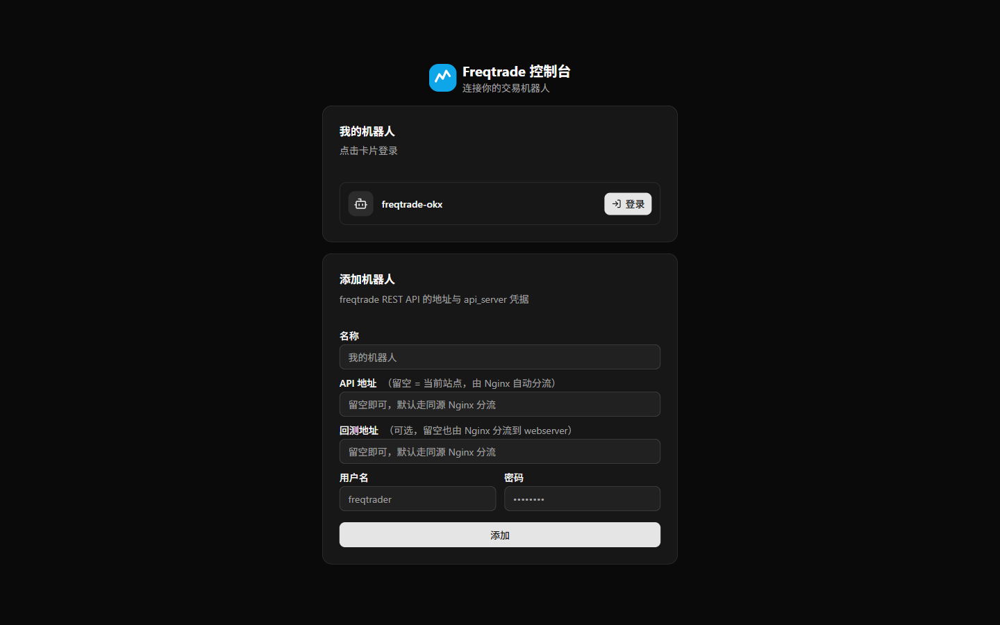
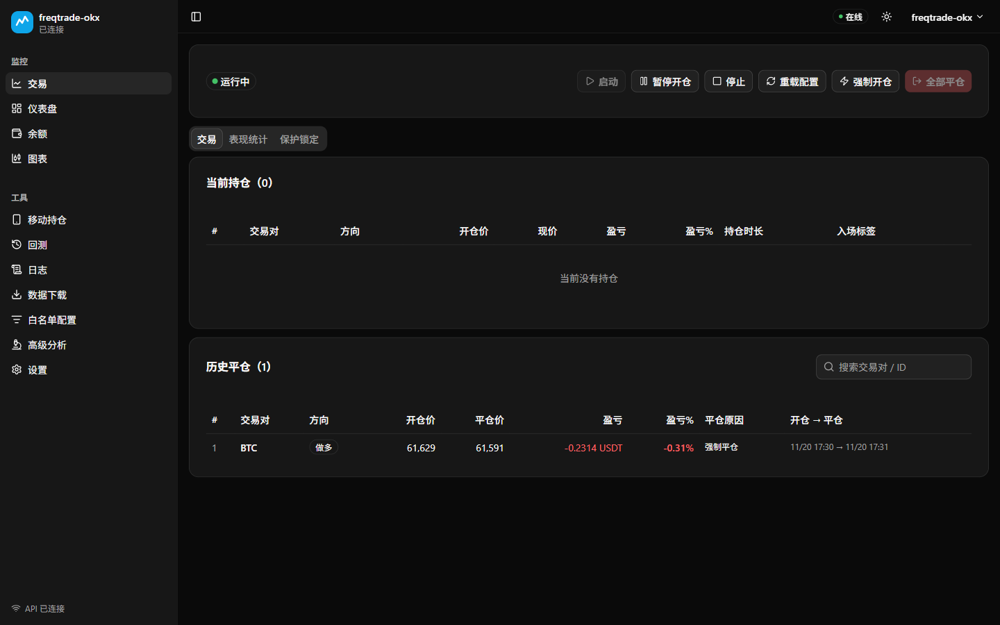
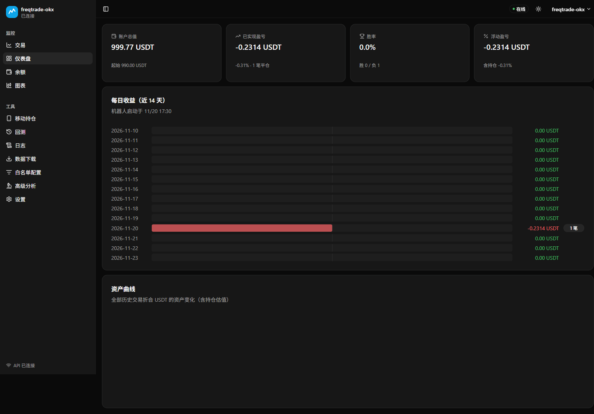
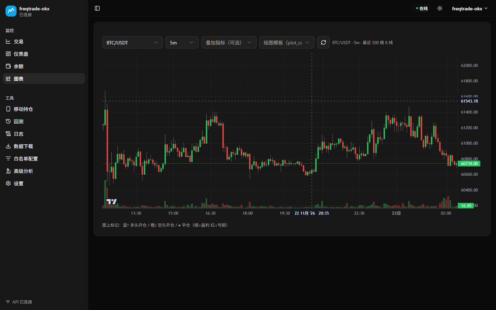
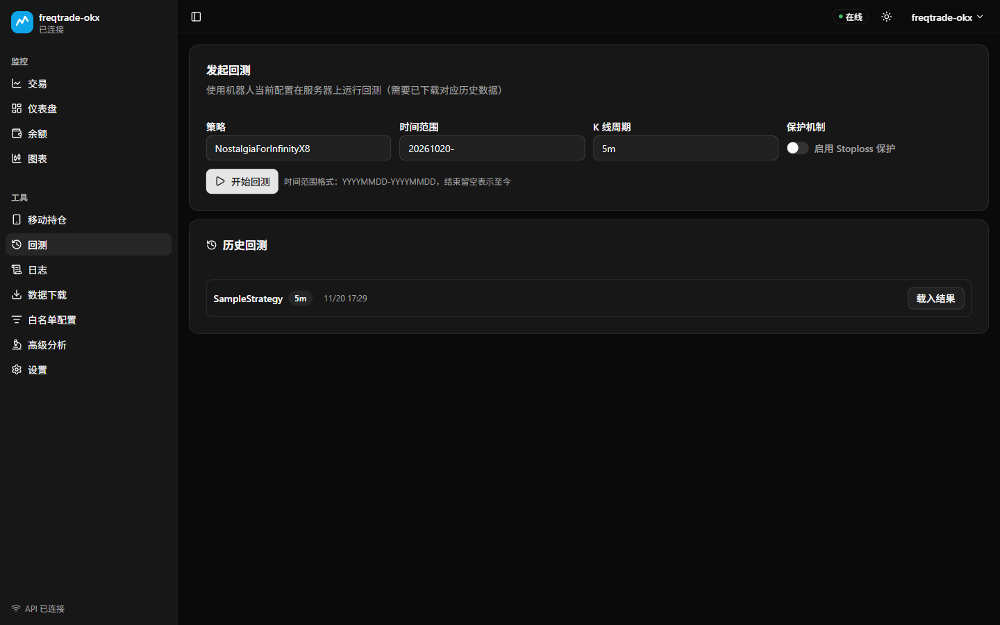
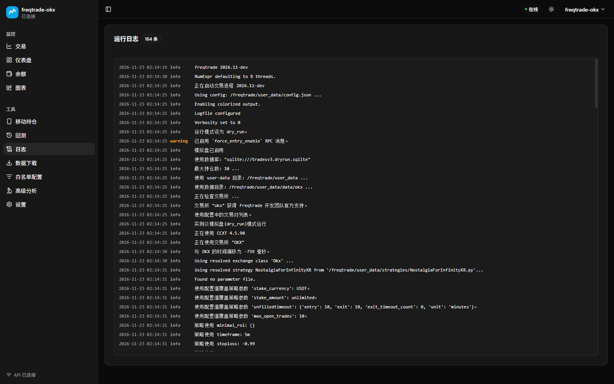
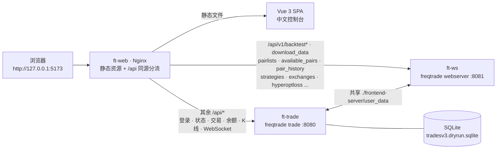

# freqtrade-suite · freqtrade 中文一体化部署套件

> 基于 [freqtrade](https://github.com/freqtrade/freqtrade)（2026.11-dev）的完整中文化部署方案：
> **汉化服务端 + 自研中文 Web 控制台 + Nginx 同源分流 + Docker Compose 一键启动**。
> 默认以 OKX **永续合约模拟盘**（dry_run，10,000 USDT，最多 3 仓，40 个主流与山寨标的）+ NostalgiaForInfinityX8 策略运行。
> 标的数量按 OKX WebSocket 限制折算：**每连接最多 240 个订阅频道**，NFI 每标的需 5 个周期（5m/15m/1h/4h/1d），40 × 5 = 200 频道。


---

## 目录

- [界面预览](#界面预览)
- [核心特性](#核心特性)
- [系统架构](#系统架构)
- [目录结构](#目录结构)
- [快速开始](#快速开始)
- [配置说明](#配置说明)
- [前端与 Nginx 分流](#前端与-nginx-分流)
- [中文化内容](#中文化内容)
- [常用命令](#常用命令)
- [本地开发](#本地开发)
- [开发流程（GitFlow）](#开发流程gitflow)
- [验证与冒烟测试](#验证与冒烟测试)
- [运维手册](#运维手册)
- [故障排查](#故障排查)
- [安全说明](#安全说明)
- [免责声明](#免责声明)

---

## 界面预览

| 登录 / 多机器人管理 | 交易控制台 |
| :---: | :---: |
|  |  |
| 同源默认地址、卡片式机器人管理、会话恢复 | 运行状态、开平仓控制、当前持仓 / 历史平仓（中文 exit_reason） |

| 仪表盘 | 图表 |
| :---: | :---: |
|  |  |
| 账户总值、已实现盈亏、胜率、每日收益、资产曲线 | 多周期 K 线、指标叠加、绘图模板、交易标记 |

| 回测 | 运行日志 |
| :---: | :---: |
|  |  |
| 发起回测、进度轮询、历史结果载入与深度分析 | 实时日志流，服务端核心日志已中文化 |

---

## 核心特性

- **全中文体验**：Telegram 命令回复、开平仓通知、启动摘要、`exit_reason`、核心运行日志均已中文化（命令名、配置键、URL 保持原样）。
- **一个入口，零跨域**：浏览器只访问 Nginx（`5173`），`/api` 由 Nginx 按路径分流到交易进程与 webserver。前端不再配置 API 地址，从机制上消除 CORS 问题。
- **双后端各司其职**：交易进程负责下单/持仓/WS 推送；webserver 负责回测、数据下载、策略列表等 freqtrade 只在 webserver 模式挂载的端点。
- **中文 Web 控制台**：Vue 3 + TypeScript + Tailwind 4 + shadcn-vue（reka-ui）+ lightweight-charts，深色主题、响应式侧边栏。
- **一键部署**：`docker compose up -d --build` 同时构建并启动 3 个服务，数据卷持久化。
- **可复现构建**：服务端基于官方 `freqtradeorg/freqtrade:stable` 镜像；`Dockerfile.freqtrade` 在其上补齐第三方策略依赖（`ta` / `finta` / `scikit-optimize`），再挂载本地源码。前端多阶段构建为 Nginx 静态站点。
- **默认安全**：模拟盘、真实密钥不入库、示例配置脱敏。

---

## 系统架构



### 为什么需要两个 freqtrade 容器？

freqtrade 官方设计上，**回测、数据下载、策略列表、Recursive / Lookahead 分析、交易对列表**等端点只在
`webserver` 模式下挂载（`webserver.py` 中以 `is_webserver_mode` 守卫）；`trade` 模式下访问会得到
`503 Bot is not in the correct state`。因此本套件同时运行：

| 服务 | 模式 | 端口 | 职责 |
|---|---|---|---|
| `ft-trade` | `trade` | 8080 | 实盘/模拟盘交易引擎、REST、WebSocket、Telegram |
| `ft-ws` | `webserver` | 8081 | 回测、数据下载、策略/交易对列表、高级分析 |
| `ft-web` | Nginx | 5173 | 前端静态资源 + `/api` 同源分流 |

两个 freqtrade 容器挂载同一份 `user_data` 与 `config.json`（JWT 密钥相同），因此 **token 互通，前端登录一次即可访问两套接口**。

### 分流规则

| 请求路径（`/api/v1/` 之后） | 上游 | 用途 |
|---|---|---|
| `backtest*` | `ft-ws:8081` | 回测、历史结果、pair_history / wallet / market_change |
| `download_data` | `ft-ws:8081` | 历史数据下载（后台任务） |
| `pairlists*` / `available_pairs` | `ft-ws:8081` | 交易对与 pairlist |
| `strategies` / `exchanges` / `hyperoptloss` | `ft-ws:8081` | 策略 / 交易所 / 超参列表 |
| `lookahead_analysis` / `recursive_analysis` | `ft-ws:8081` | 高级分析 |
| `freqaimodels` | `ft-ws:8081` | FreqAI 模型列表（当前镜像缺依赖，见「故障排查」） |
| **其余所有 `/api/*`** | `ft-trade:8080` | 登录、状态、交易、余额、K 线、`plot_config`、WebSocket |

> 新增 webserver 专属接口时，只需把路径前缀加入 `frontend-web/nginx.conf` 的正则分组。

---

## 目录结构

```text
freqtrade-suite/
├── AGENTS.md                       # 团队开发手册（智能体与协作者必须遵守）
├── CHANGELOG.md                    # 变更日志
├── .github/workflows/ci.yml        # CI：前端 typecheck/lint/test/build + 服务端校验
├── docker-compose.yml              # 编排 ft-trade / ft-ws / ft-web
├── Dockerfile.freqtrade            # 后端自定义镜像：官方 stable digest + 第三方策略依赖
├── docs/
│   ├── images/                     # README 截图
│   ├── DEVELOPMENT_WORKFLOW.md     # GitFlow 分支/PR/发布流程规范
│   ├── PATCHES.md                  # 服务端中文化/行为补丁清单（升级 freqtrade 时核对）
│   └── STRATEGIES.md               # 策略清单、质量分级与回测对比
├── frontend-server/                # freqtrade 2026.11-dev 源码（含中文化修改）
│   ├── Dockerfile                  # 运行基座说明（实际使用官方 stable 镜像 + 源码挂载）
│   ├── freqtrade/                  # 核心源码
│   │   └── rpc/                    # Telegram / RPC 中文化补丁
│   └── user_data/
│       ├── config.example.json     # 脱敏配置模板（复制为 config.json）
│       ├── config_ws.json          # webserver 模式的端口覆盖（8081）
│       └── strategies/             # 55 个策略文件（含来源清单 _SOURCES.md）
└── frontend-web/                   # 自研中文前端（Vue 3 + Vite + TS）
    ├── src/
    │   ├── api/client.ts           # API 客户端：同源/直连、JWT 登录与自动续期
    │   ├── api/ws.ts               # WebSocket 封装（同源自动推导 ws://）
    │   ├── stores/auth.ts          # 多机器人管理、旧地址自动迁移、会话恢复
    │   ├── views/                  # 交易 / 仪表盘 / 图表 / 回测 / 日志 / 设置...
    │   └── components/             # shadcn-vue 组件与业务组件
    ├── nginx.conf                  # 同源入口 + 按路径分流
    └── Dockerfile                  # node 构建 → nginx 运行
```

---

## 快速开始

### 环境要求

- Docker Desktop（含 Docker Compose v2）
- 建议 4 GB 以上可用内存（freqtrade + webserver + nginx）
- 可访问 OKX 与 npm / PyPI（首次构建需要）

### 1. 克隆

```bash
git clone https://github.com/yhemeo613/freqtrade-suite.git
cd freqtrade-suite
```

### 2. 准备配置

```bash
cp frontend-server/user_data/config.example.json frontend-server/user_data/config.json
```

编辑 `frontend-server/user_data/config.json`：

- `exchange.key` / `secret` / `password`：OKX API 凭据（**模拟盘可留空**，实盘必填）
- `api_server.username` / `password`：Web 控制台登录凭据（务必修改）
- `api_server.jwt_secret_key`：随机字符串，例如 `openssl rand -hex 32`
- `telegram.*`：可选，填入 Bot Token 与 Chat ID 后启用中文 Telegram 通知
- 其余（交易对、策略、金额等）按需调整

> `config.json` 已被 `.gitignore` 排除，**不会进入仓库**。

### 3. 启动

```bash
docker compose up -d --build
```

首次构建约 1–3 分钟（前端 npm 构建 + 拉取镜像）。

### 4. 访问与登录

- Web 控制台：<http://127.0.0.1:5173>
- 交易 API：<http://127.0.0.1:8080>（调试用，前端无需直连）
- 回测服务：<http://127.0.0.1:8081>（调试用，前端由 Nginx 自动分流）

登录步骤：

1. 打开控制台 → 添加机器人
2. **API 地址与回测地址留空**（默认走同源 Nginx 分流）
3. 填入 `api_server.username` / `api_server.password`
4. 点击「登录」

> 留空地址的机器人会在卡片上只显示名称；如需连接远程 freqtrade，可填写完整 URL。

---

## 配置说明

`frontend-server/user_data/config.json` 中与套件相关的关键项：

| 配置项 | 说明 |
|---|---|
| `dry_run` | `true` 为模拟盘；切换实盘前务必确认策略与风控 |
| `dry_run_wallet` | 模拟盘初始资金，默认 `10000`（USDT） |
| `stake_amount` | 单仓保证金，默认 `unlimited`（NFI 推荐口径：每仓 = 可用资金 / 最大持仓数，补仓使用剩余保证金） |
| `max_open_trades` | 最大同时持仓数，默认 `3` |
| `trading_mode` / `margin_mode` | 交易模式，默认 `futures`（永续合约）/ `isolated`（逐仓） |
| `exchange.pair_whitelist` | 交易标的，默认 **40 个** OKX USDT 永续（主流 + 主流山寨，均要求上市满 90 天；数量受 OKX WS 每连接 240 频道限制：NFI 每标的 5 周期 → 40×5=200 频道） |
| `exchange.name` | 默认 `okx`，可替换为 freqtrade 支持的其他交易所 |
| `exchange.ccxt_config` | REST 限流参数，默认 `{"enableRateLimit": true, "rateLimit": 200}`（遵守交易所请求频率） |
| `exchange.enable_ws` | WebSocket 开关（默认开启）；WS 订阅按交易所配额（OKX 480 次/小时）自动节流，超配额通道自动回退 REST |
| `exchange_ws_sub_limit_per_hour` / `exchange_ws_max_channels` | WS 订阅配额与单连接频道上限（可选覆盖，默认 480 / 240，与 OKX 官方限制一致）；换交易所或调整策略周期数时按需调整，无需改代码 |
| `exchange.key/secret/password` | 交易所凭据；模拟盘可留空，实盘必填 |
| `api_server.listen_port` | 交易进程 API 端口，默认 `8080`（与 compose 端口映射一致） |
| `api_server.username/password` | Web 控制台登录凭据 |
| `api_server.jwt_secret_key` | JWT 签名密钥；trade 与 webserver 必须一致才能 token 互通 |
| `api_server.CORS_origins` | 直连 API 时的跨域白名单；同源分流下前端不依赖它 |
| `strategy` | 默认 `NostalgiaForInfinityX8`（也可由 compose `--strategy` 指定） |
| `telegram.enabled/token/chat_id` | 中文 Telegram 通知（可选） |
| `telegram.selfheal` | 轮询自愈看门狗开关（默认 `true`）；关闭后轮询卡顿时不再自动重建应用，也不再产生额外健康检查请求 |

`config_ws.json` 仅覆盖 webserver 的监听端口（`8081`），其余配置继承 `config.json`。

---

## 前端与 Nginx 分流

### 同源原则

前端所有请求都发往**当前页面源**（如 `http://127.0.0.1:5173/api/v1/...`），由 Nginx 转发：

- 浏览器视角：只有一个源，无预检、无 CORS、无端口耦合；
- 后端视角：两个 freqtrade 进程仍按各自职责监听 8080 / 8081；
- 用 `localhost` 或 `127.0.0.1` 访问都可以，不再需要同步修改 `CORS_origins`。

### 地址兼容

旧版本保存的 `http://localhost:8080` / `http://127.0.0.1:8080` 机器人地址，会在前端启动时自动规整为空（同源），无需手动清理。

### WebSocket

`src/api/ws.ts` 在 API 地址为空时按当前页面推导 `ws://<host>/api/v1/message/ws`，Nginx 已配置 `Upgrade` / `Connection` 透传。

---

## 中文化内容

| 模块 | 内容 |
|---|---|
| Telegram | 39 个命令回复、开平仓/取消/保护/强平通知、启动摘要、按钮文案 |
| RPC 状态 | 状态、表现、余额等输出文案 |
| `exit_reason` | `trailing_stop_loss → 移动止损`、`roi → 止盈`、`stop_loss → 止损`、`force_exit → 手动平仓` 等 |
| 核心日志 | worker 心跳、配置加载、交易对刷新、模拟盘提示等 |
| 前端 | 全中文界面、中文错误提示、中文交易原因 |

> 命令名（`/status` 等）、配置键、URL、枚举值保持英文，避免破坏兼容性。

---

## 常用命令

```bash
# 查看状态
docker compose ps

# 跟踪交易日志
docker compose logs -f ft-trade

# 重启单个服务
docker compose restart ft-web

# 更新前端（改代码后）
docker compose up -d --build web

# 停止（保留数据）
docker compose down

# 在容器内执行 freqtrade 子命令
docker compose exec ft-trade freqtrade backtesting --config /freqtrade/user_data/config.json --strategy NostalgiaForInfinityX8
docker compose exec ft-ws freqtrade download-data --config /freqtrade/user_data/config.json --timeframes 5m 1h --days 30

# 查看回测结果目录
ls frontend-server/user_data/backtest_results/
```

---

## 本地开发

### 前端（frontend-web）

```bash
cd frontend-web
npm install          # 首次安装依赖
npm run dev          # 开发服务器（http://127.0.0.1:8090，/api 代理到 8080）
```

质量检查命令（与 CI 一致，提交前建议全跑）：

```bash
npm run typecheck    # vue-tsc 类型检查
npm run lint         # ESLint（0 警告基线）
npm run format:check # Prettier 格式检查（npm run format 自动修复）
npm run test         # Vitest 单测
npm run build        # 生产构建
```

技术栈与约定：
- **Vue 3 + TypeScript + Vite + Tailwind 4 + shadcn-vue(reka-ui) + lightweight-charts**
- API 响应类型集中在 `src/api/types.ts`（与服务端 `api_schemas.py` 对齐）
- 视图在 `src/views/`，业务组件在 `src/components/ft/`，通用 UI 在 `src/components/ui/`（shadcn 生成，勿手改样式约定）
- 轮询统一用 `usePolling`（页面隐藏自动暂停）；空态统一用 `EmptyState`

Vite 开发服务器监听 `8090`，并将 `/api` 代理到 `http://127.0.0.1:8080`。
改动 `frontend-web/nginx.conf` 后需重新构建 `web` 服务才会在生产入口生效。

### 服务端（frontend-server）

服务端是 freqtrade 源码的本地副本，以挂载方式运行；修改后重启对应容器即可生效：

```bash
docker compose restart freqtrade    # 交易进程
docker compose restart freqtrade-ws # webserver
```

---

## 开发流程（GitFlow）

本项目采用 **GitFlow 分支模型 + GitHub PR 驱动**：`main`（可发布，打 tag）← `release/vX.Y.Z` ← `develop`（集成分支）← `feature/*`；紧急修复走 `hotfix/*`。

- 团队作业规范见 **`AGENTS.md`**
- 分支、提交、PR、发布/打 tag 的完整命令流程见 **`docs/DEVELOPMENT_WORKFLOW.md`**
- 策略清单、质量分级与回测对比见 **`docs/STRATEGIES.md`**（可复用脚本 `scripts/compare_strategies.py`）
- 每个 PR 由 CI（`typecheck`/`lint`/`test`/`build`）自动验证，绿勾后合并
- 提交信息使用 Conventional Commits 前缀（`feat` / `fix` / `docs` / `refactor` / `perf` / `ci` / `test` / `chore`）

> 发布流程：从 `develop` 切 `release/vX.Y.Z` → 合并到 `main` → 打 annotated tag → 创建 GitHub Release → 合并回 `develop`。示例见 CHANGELOG.md。

---

## 验证与冒烟测试

部署完成后（或每次发布前）运行全栈冒烟测试，验证 Nginx 同源分流、安全头、gzip 与后端健康：

```bash
python scripts/smoke_test.py                # 默认入口 http://127.0.0.1:5173
python scripts/smoke_test.py --skip-docker  # 仅检查 HTTP 层（入口已可达时）
```

脚本零依赖（python3 标准库 + docker compose），退出码 `0` 表示全部通过。

浏览器手工冒烟（发布前建议快速过一遍）：

1. 打开 `http://127.0.0.1:5173`，登录页正常渲染（深色主题、中文字段）
2. F12 Console 无红色报错
3. 登录后依次切换：交易 / 仪表盘 / 图表 / 日志 / 设置，页面无白屏
4. 切换亮/暗主题，样式正常

---

## 运维手册

### 数据备份（建议每日）

需要备份的内容在 `frontend-server/user_data/`：

| 路径 | 内容 |
|---|---|
| `tradesv3.dryrun.sqlite` | 交易数据库（持仓/历史） |
| `backtest_results/` | 回测结果（可重新生成，按需备份） |
| `data/` | 下载的历史 K 线（体积大，可重新下载） |
| `config.json` | 机器人配置（**含私密凭据，勿外传**） |

```bash
# 示例：打包备份（保留最近 7 份）
tar -czf backups/user_data-$(date +%F).tgz -C frontend-server/user_data \
  tradesv3.dryrun.sqlite config.json backtest_results
```

### 升级 freqtrade

1. 在 `docker-compose.yml` 中把镜像 digest 替换为新版本（`docker compose pull` 前先查最新 digest）
2. 按 `docs/PATCHES.md` 核对中文化补丁是否需要重放
3. `docker compose up -d` 后运行 `python scripts/smoke_test.py` 验证
4. 观察 `docker compose logs -f ft-trade` 无异常

### 日志与排障

```bash
docker compose logs -f ft-trade        # 交易进程日志（中文化）
docker compose logs -f freqtrade-ws    # 回测服务日志
docker compose logs ft-web             # Nginx 访问/错误日志（已脱敏，不含 token）
docker compose ps                      # 健康状态
```

- 日志文件同时写入 `frontend-server/user_data/logs/`，注意定期清理避免占满磁盘。
- 前端问题先看浏览器 F12 → Network/Console，再对照「故障排查」章节。

### 监控建议

- 外部监控可探测 `http://127.0.0.1:5173/`（SPA）与 `/api/v1/ping`（返回 `{"status":"pong"}`）
- 容器自带 healthcheck：`ft-trade` / `ft-ws` 不健康时 `ft-web` 不会启动
- 内存建议 ≥ 4 GB；`data/` 与 `backtest_results/` 会随使用增长，建议定期清理

---

## 故障排查

### 登录提示 `Failed to fetch`

- 确认三个容器均为 `Up`：`docker compose ps`
- 确认访问的是 `http://127.0.0.1:5173`（或 `http://localhost:5173`），不要直连 8081
- 打开浏览器 F12 → Network，看失败请求的路径：若为 `/api/...`，检查 Nginx 日志 `docker compose logs ft-web`
- 旧版本页面残留：`Ctrl + F5` 强制刷新

### 交易对 / 回测接口 502

- 检查 `ft-ws` 是否在运行：`docker compose ps`
- 检查 Nginx 是否把该路径分到了正确上游：`docker compose logs ft-web | grep <路径>`
- 例如 `plot_config` 属于交易进程，不应分流到 8081

### `freqaimodels` 返回 500（`No module named 'datasieve'`）

官方 `stable` 镜像不含 FreqAI 可选依赖，属预期行为，前端已做降级。需要 FreqAI 时：
把 `docker-compose.yml` 中两个 freqtrade 服务的镜像换成 `freqtradeorg/freqtrade:stable_freqai`
（RL 需求用 `stable_freqairl`）并重建。

### OKX 时间偏移告警

日志出现「与 OKX 的时间偏移约 -xxx 毫秒」时，请同步宿主机 NTP。偏移过大会导致下单签名被拒。

### webserver 提示 `Strategy is mandatory in webserver mode`

webserver 子命令**不接受 `--strategy` 命令行参数**（会报 `unrecognized arguments`）。
策略应写在 `config_ws.json` 的 `strategy` 字段（本套件已内置
`NostalgiaForInfinityX8`），或使用 `freqtrade webserver` 支持的方式指定。

### 端口被占用

`5173` / `8080` / `8081` 任一被占用时，修改 `docker-compose.yml` 的端口映射（左侧宿主端口）即可；
前端仍通过 Nginx 同源访问，无需改代码。

---

## 安全说明

- **真实密钥不入库**：`frontend-server/user_data/config.json` 已被 `.gitignore` 排除；仓库内仅保留脱敏模板 `config.example.json`。
- **强烈建议保持模拟盘**直到策略与风控验证完成；切换到实盘前请复核 `dry_run`、交易对、仓位与止损配置。
- **修改默认凭据**：`api_server.username/password`、`jwt_secret_key` 不要使用示例值。
- `.env`、数据库、日志、回测结果均不入库。
- 本套件面向自托管部署；请勿将包含密钥的 `config.json` 提交到任何仓库。
- 开源前检查清单与历史扫描结论见 **`docs/OPEN_SOURCE.md`**。

---

## 免责声明

本项目仅用于技术学习与策略研究。加密货币交易存在极高风险，**任何实盘操作请自行承担全部责任**。
freqtrade 及其作者、本项目作者不对任何交易结果负责。请先使用模拟盘充分验证。

## License

本项目以 **GPL-3.0** 发布（见根目录 [`LICENSE`](LICENSE)）：

- `frontend-server/` 为 [freqtrade](https://github.com/freqtrade/freqtrade)（GPL-3.0）源码副本，中文化补丁见 `docs/PATCHES.md`
- `frontend-server/user_data/strategies/` 下第三方策略按各自上游许可：
  - 官方策略、`NostalgiaForInfinityX8`、`BB_RPB_TSL`：GPL-3.0
  - `CryptoFrog`：Apache-2.0；`DcaTp`：MIT
  - **无 LICENSE 的 8 个策略不随仓库分发**（`ClucHAnix`、`ClucHAnix_5m`、`E0V1E`、`E0V1EN`、`MarketStructureCHOCH`、`NASOSv4`、`NASOSv5_mod3`、`TrendLines`），需要时运行 `python scripts/fetch_optional_strategies.py` 在本机自行获取（详见 `_SOURCES.md`）
- 本套件的前端、编排与中文化修改同样以 GPL-3.0 发布
